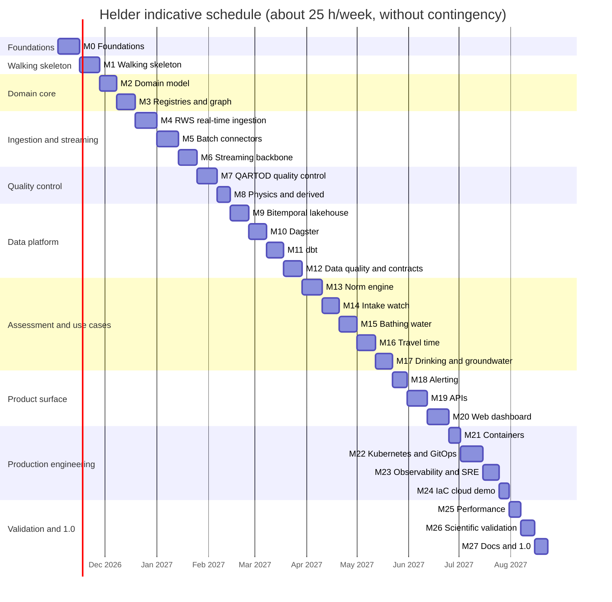
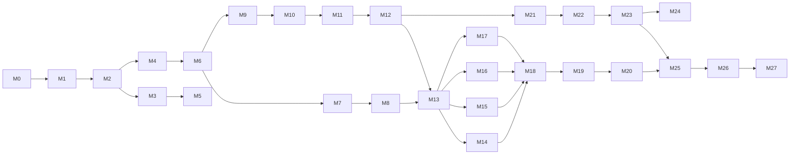

# Roadmap

> **Status (2026-11-03):** planning is complete: domain research, data sources verified
> against the live services, technology landscape, twenty ADRs and the target architecture
> (M0.1–M0.4). The next item is **M0.5**, the Python workspace.

Helder is built in ten phases and 28 milestones. A thin end-to-end slice comes first (M1), and
every later milestone deepens one stage of that slice, so the platform works from early on and
gets better with each step.

## How to read this roadmap

- **IDs** are `M<milestone>.<item>`. Each open item has one GitHub issue, created and closed by
  `scripts/sync_roadmap_issues.py`; this file stays the source of truth.
- **Estimates** are hours of focused work, including tests and documentation for that item.
- **`[x]`** marks items merged to `main`. Exit criteria must hold before a milestone closes.
- **Spike** items answer a question and record the answer (usually in an ADR) before the
  dependent work starts.
- Background for every decision: [domain research](docs/research/01-water-quality-domain.md),
  [data sources](docs/research/02-data-sources.md),
  [technology landscape](docs/research/03-technology-landscape.md),
  [architecture](docs/architecture.md) and [ADRs](docs/adr/README.md).

## Summary

<!-- summary:start -->
| Phase | Milestone | Items | Hours | Release |
| :-- | :-- | --: | --: | :-- |
| 0. Foundations | [M0 Engineering foundations](#m0--engineering-foundations) | 13 | 48 |  |
| 1. Walking skeleton | [M1 Walking skeleton: thin end-to-end slice](#m1--walking-skeleton-thin-end-to-end-slice) | 13 | 44 | v0.1.0 |
| 2. Domain core and reference data | [M2 Domain model, units, time and identifiers](#m2--domain-model-units-time-and-identifiers) | 10 | 34 |  |
|  | [M3 Registries, reference data and the source-to-tap graph](#m3--registries-reference-data-and-the-source-to-tap-graph) | 12 | 40 |  |
| 3. Ingestion and streaming | [M4 Real-time RWS ingestion](#m4--real-time-rws-ingestion) | 14 | 46 |  |
|  | [M5 Batch connectors](#m5--batch-connectors) | 14 | 48 |  |
|  | [M6 Streaming backbone](#m6--streaming-backbone) | 11 | 38 | v0.2.0 |
| 4. Quality control and physics | [M7 Sensor quality control (QARTOD)](#m7--sensor-quality-control-qartod) | 14 | 44 |  |
|  | [M8 Physics consistency and derived variables](#m8--physics-consistency-and-derived-variables) | 9 | 30 |  |
| 5. Data platform | [M9 Lakehouse: bitemporal DuckLake](#m9--lakehouse-bitemporal-ducklake) | 12 | 40 |  |
|  | [M10 Orchestration with Dagster](#m10--orchestration-with-dagster) | 12 | 40 |  |
|  | [M11 Transformations with dbt](#m11--transformations-with-dbt) | 11 | 36 |  |
|  | [M12 Data quality, contracts and data observability](#m12--data-quality-contracts-and-data-observability) | 11 | 38 | v0.3.0 |
| 6. Assessment and use cases | [M13 Norm registry and assessment engine](#m13--norm-registry-and-assessment-engine) | 12 | 42 |  |
|  | [M14 Salt intrusion and intake watch](#m14--salt-intrusion-and-intake-watch) | 10 | 34 |  |
|  | [M15 Bathing water and cyanobacteria](#m15--bathing-water-and-cyanobacteria) | 11 | 38 |  |
|  | [M16 Upstream early warning and travel time](#m16--upstream-early-warning-and-travel-time) | 11 | 40 |  |
|  | [M17 Drinking water and groundwater](#m17--drinking-water-and-groundwater) | 10 | 34 | v0.4.0 |
| 7. Product surface | [M18 Alerting](#m18--alerting) | 10 | 33 |  |
|  | [M19 APIs: SensorThings and derived products](#m19--apis-sensorthings-and-derived-products) | 12 | 42 |  |
|  | [M20 Web dashboard](#m20--web-dashboard) | 14 | 48 | v0.5.0 |
| 8. Production engineering | [M21 Containers and supply chain](#m21--containers-and-supply-chain) | 9 | 26 |  |
|  | [M22 Kubernetes and GitOps](#m22--kubernetes-and-gitops) | 13 | 46 |  |
|  | [M23 Observability and SRE](#m23--observability-and-sre) | 10 | 36 |  |
|  | [M24 Infrastructure as code (optional cloud demo)](#m24--infrastructure-as-code-optional-cloud-demo) | 6 | 20 | v0.6.0 |
| 9. Validation and 1.0 | [M25 Performance, resilience and scale](#m25--performance-resilience-and-scale) | 8 | 26 |  |
|  | [M26 Scientific validation and reproducibility](#m26--scientific-validation-and-reproducibility) | 8 | 30 |  |
|  | [M27 Documentation, write-up and 1.0](#m27--documentation-write-up-and-10) | 8 | 28 | v1.0.0 |
| | **Total** | **308** | **1,049** | |

**Done:** 44 h (11 of 308 items). **Open:** 1,005 h. With 15 % contingency the total is about 1,206 hours:
roughly 10 to 11 months at 25 hours a week.
<!-- summary:end -->

### Indicative schedule

<!-- gantt:start -->

<!-- gantt:end -->

### Critical path

Batch connectors (M5) can run in parallel with the streaming work once the registries (M3)
exist, and containers (M21) can start as soon as the services exist.

## Principles

1. **Rules and physics, never learned models.** Every flag, status and alert is explained by a
   rule, an equation or a cited norm ([ADR-0002](docs/adr/0002-deterministic-rule-based-processing.md)).
2. **Small data by design.** Watchlists, filters at the source, budgets that fail closed
   ([ADR-0003](docs/adr/0003-small-data-by-design.md)).
3. **Never lose history.** Observations are bitemporal; revisions and rule changes are
   replayable ([ADR-0009](docs/adr/0009-bitemporal-observations.md)).
4. **Every number has a source.** Norms carry legal force and citation; data carries attribution
   ([ADR-0013](docs/adr/0013-norms-as-code.md), [ADR-0020](docs/adr/0020-privacy-attribution-and-source-terms.md)).
5. **Contracts first.** Schemas and contracts change before the code that uses them
   ([ADR-0014](docs/adr/0014-data-contracts-and-schemas.md)).
6. **Open standards.** Aquo, OGC SensorThings, OGC API Features, CAP 1.2, CloudEvents, ODCS,
   OpenAPI, AsyncAPI.
7. **One implementation per rule.** The same QC code runs in the stream and in backfills
   ([ADR-0007](docs/adr/0007-quix-streams-shared-qc-library.md)).
8. **Everything as code.** Infrastructure, dashboards, alerts, policies, norms, QC thresholds and
   repository settings.
9. **Informational, not advisory.** Helder shows data and yardsticks and links to the
   authorities that give advice.

## Definition of done (every item)

- [ ] Merged by pull request with CI green; Conventional Commit messages.
- [ ] Tests at the right level (unit, property, integration, end-to-end); coverage does not drop.
- [ ] `ruff`, `mypy --strict` and `lint-imports` pass; SQL passes SQLFluff.
- [ ] Docs updated: reference for interfaces, a how-to for anything a user runs.
- [ ] Schemas and contracts updated first; breaking changes versioned.
- [ ] No secrets, no personal data, budgets respected, sources attributed.
- [ ] An ADR is added or superseded when a recorded decision changes.
- [ ] This file is ticked and README.md is updated if the change affects it.

---

## Phase 0: Foundations

### M0 · Engineering foundations

**Goal:** a repository where every later change is linted, typed, tested, documented and
released automatically.

- [x] **M0.1** (2 h) Repository bootstrap: MIT licence, `.gitignore`, `.editorconfig`,
  `.gitattributes`, `.env.example`, pre-commit with gitleaks, codespell, markdownlint and
  Conventional Commits.
- [x] **M0.2** (14 h) Planning: domain research, data sources verified against the live
  services, technology landscape, twenty ADRs, architecture and this roadmap.
- [x] **M0.3** (3 h) Repository settings as code (`scripts/repo-settings.sh`): merge commits
  only, a ruleset that forbids force-pushes and deleting `main`, secret scanning with push
  protection, private vulnerability reporting, topics and labels.
- [x] **M0.4** (3 h) Roadmap-to-issues sync (`scripts/sync_roadmap_issues.py`): milestones,
  labels and one issue per open item, idempotent, closes issues for ticked items.
- [x] **M0.5** (5 h) uv workspace with the eleven packages from
  [ADR-0017](docs/adr/0017-python-toolchain-monorepo.md); Python 3.13 pin and `uv.lock`; Ruff,
  mypy (strict), pytest with Hypothesis and branch coverage failing under 85 %; import-linter
  contracts for the dependency rules.
- [x] **M0.6** (2 h) `justfile` (`setup`, `fmt`, `lint`, `typecheck`, `test`, `docs`, `up`,
  `down`, `e2e`, `budget`), `mise.toml` for tool versions and a devcontainer.
- [x] **M0.7** (3 h) Dependency policy: `tools/check_dependencies.py` fails on licences outside
  the allowlist and on any ML library, model runtime, model API client or vector database;
  runs in pre-commit and CI. Renovate: grouped, scheduled, digests pinned.
- [x] **M0.8** (5 h) GitHub Actions CI: lint, type check, hooks and tests (matrix by marker),
  uv cache, concurrency groups, read-only default permissions, actions pinned by commit SHA,
  coverage in the job summary, gitleaks over the full history and one aggregate `CI passed`
  check; a `require-ci` ruleset.
- [x] **M0.9** (2 h) Extend pre-commit with Ruff, mypy, import-linter, uv-lock, actionlint,
  ShellCheck, hadolint, yamllint and check-jsonschema.
- [x] **M0.10** (3 h) Documentation site with Zensical in the Diátaxis structure (tutorials,
  how-to guides, reference, explanation), research and ADR pages, deployed to GitHub Pages by a
  workflow.
- [x] **M0.11** (2 h) Community files: CONTRIBUTING, CODE_OF_CONDUCT, SECURITY (private
  vulnerability reporting), issue forms (bug, feature, spike, data issue), pull request template
  and CODEOWNERS.
- [ ] **M0.12** (2 h) Releases: release-please with Conventional Commits, CHANGELOG and a
  `CITATION.cff` validated in pre-commit.
- [ ] **M0.13** (2 h) OpenSSF Scorecard workflow, Dependabot security alerts and a badge row
  in the README.

**Exit criteria:** a pull request that breaks formatting, lint, types, tests, licences or the
ML deny-list cannot merge; documentation publishes on merge; a release pull request opens
automatically.

## Phase 1: Walking skeleton

### M1 · Walking skeleton: thin end-to-end slice

**Goal:** one real signal (chloride near three drinking water intakes) flows from RWS through
Kafka, quality control, DuckLake, dbt and the API to a chart, on a laptop, with one command.

- [ ] **M1.1** (3 h) Recorded fixtures: trimmed WFS CSV and API JSON for `kinderdijk.lek`,
  `haringvliet.4` and `markermeer.midden`; a fake RWS service (FastAPI) that serves them.
- [ ] **M1.2** (4 h) Minimal poller: WFS query for chloride with a time window, CSV parsing,
  MET-to-UTC conversion, series key, JSON output.
- [ ] **M1.3** (4 h) Compose platform v0: Kafka (KRaft), Apicurio Registry, PostgreSQL, RustFS,
  Dagster webserver and daemon; health checks; `just up` and `just down`.
- [ ] **M1.4** (3 h) Publish raw observation events to Kafka with CloudEvents headers and a JSON
  payload (Avro arrives in M6).
- [ ] **M1.5** (4 h) Minimal QC consumer with Quix Streams: gross range test only, flagged
  events on an output topic.
- [ ] **M1.6** (5 h) Spike: DuckLake 1.0 with DuckDB 2.0 on PostgreSQL and RustFS; dbt-duckdb
  and the dlt `ducklake` destination against the attached catalog; findings recorded in
  [ADR-0008](docs/adr/0008-ducklake-lakehouse.md).
- [ ] **M1.7** (4 h) Lake writer: micro-batch appends of flagged observations to
  `clean.observation` (single-temporal for now).
- [ ] **M1.8** (3 h) First dbt chain: staging model and `obs_daily` with chloride daily means,
  tests and a model contract.
- [ ] **M1.9** (3 h) Dagster code location: dbt assets, a 10-minute schedule and one blocking
  asset check.
- [ ] **M1.10** (3 h) FastAPI service with `/health` and `/v1/series/{id}/daily`; OpenAPI
  document published with the docs.
- [ ] **M1.11** (3 h) `helder demo` command that renders a chart of daily mean chloride against
  the 150 mg/l and 200 mg/l lines, used in the README.
- [ ] **M1.12** (4 h) End-to-end test in CI: Compose with the fake RWS service, one poll, and
  the API returns the expected daily mean.
- [ ] **M1.13** (1 h) Release v0.1.0 with notes and a walkthrough in the docs.

**Exit criteria:** `just up && just e2e` passes on a fresh clone in under 15 minutes; v0.1.0 is
tagged.

## Phase 2: Domain core and reference data

### M2 · Domain model, units, time and identifiers

**Goal:** the shared language of the platform, in pure, well-tested Python.

- [ ] **M2.1** (4 h) Core types: Station, Series, ObservedProperty, Observation, QCResult,
  Censoring and Provenance as frozen Pydantic models with validation.
- [ ] **M2.2** (3 h) Aquo vocabulary: compartment, quantity, parameter, unit and condition codes
  with English labels and UCUM mappings for the codes Helder uses.
- [ ] **M2.3** (4 h) Units with Pint: custom units (`DIMSLS`, `RFU`, `NTU`, `n/l`,
  `cfu/100ml`, `mS/m`), conversions and Hypothesis round-trip tests.
- [ ] **M2.4** (3 h) Time: parsing fixed `+01:00` source times, UTC normalisation, 10-minute
  alignment, and property tests across daylight-saving boundaries.
- [ ] **M2.5** (3 h) Series identity: UUIDv5 scheme over the identifying attributes, a
  human-readable key, and stability tests.
- [ ] **M2.6** (3 h) Censored values: limit symbols, LOQ, and half-LOQ helpers per Commission
  Directive 2009/90/EC.
- [ ] **M2.7** (4 h) Event schemas: Avro for raw, flagged, revision, registry and alert events;
  CloudEvents attribute conventions; an AsyncAPI 3.1 document.
- [ ] **M2.8** (4 h) ODCS 3.2 contracts v0 for `clean.observation`, `clean.series` and
  `curated.obs_daily`; `datacontract lint` in CI.
- [ ] **M2.9** (3 h) Source registry `reference/sources.yaml` with a JSON Schema: terms,
  citation, budgets and an `enabled` gate; an attribution builder.
- [ ] **M2.10** (3 h) Settings with Pydantic: environment validation and a check that keeps
  `.env.example` in sync with the code.

**Exit criteria:** `helder-core` has 95 % branch coverage, no I/O imports, and every unit and
time conversion is covered by property tests.

### M3 · Registries, reference data and the source-to-tap graph

**Goal:** know what is measured where, what matters, and how water flows from a river to a tap.

- [ ] **M3.1** (4 h) Aquo domain tables: choose the authoritative sync path (aquo.nl API, RWS
  embedded descriptions or RWS spreadsheets); load the quality code table.
- [ ] **M3.2** (4 h) RWS catalogue ingestion: daily, joined by message IDs into station and
  series registries (type 2 slowly changing dimensions) with change detection.
- [ ] **M3.3** (3 h) Series activity from the latest layer (active, dormant, ended); registry
  events on compacted topics.
- [ ] **M3.4** (4 h) Watchlist: YAML schema, default selection rules (near intakes, bathing
  waters, key lakes and their upstream stations), a budget estimate per watchlist and a
  `helder watchlist preview` command.
- [ ] **M3.5** (3 h) RIVM intakes, pumping stations and supply areas; geometry simplification;
  RD New and ETRS89 handling with pyproj.
- [ ] **M3.6** (4 h) Station-to-intake links: candidates by distance and water body, a reviewed
  mapping file with reasons, and tests.
- [ ] **M3.7** (3 h) PDOK geometries: bathing water locations, water board areas, the waterway
  network, and waste water treatment plants with their outfalls.
- [ ] **M3.8** (4 h) Source-to-tap graph tables with provenance; upstream and downstream queries
  in SQL (recursive CTEs) and Python.
- [ ] **M3.9** (3 h) Bathing water matching: EEA identifiers, PDOK locations and RWS sampling
  locations, with a match-quality score and a review list.
- [ ] **M3.10** (3 h) Registry endpoints: `/v1/stations`, `/v1/series`, `/v1/intakes` and
  `/v1/graph/...`.
- [ ] **M3.11** (2 h) Registry contracts and generated reference pages.
- [ ] **M3.12** (3 h) Registry checks: orphan series, unmapped codes, coordinates outside the
  Netherlands (Caribbean Netherlands handled explicitly) and duplicate names.

**Exit criteria:** for each of the 23 intakes the API lists its nearby stations, its pumping
station and supply area, and its upstream stations, each link with provenance.

## Phase 3: Ingestion and streaming

### M4 · Real-time RWS ingestion

**Goal:** every new value of every watchlist series reaches Kafka once, on time, with gaps
repaired and revisions captured ([ADR-0005](docs/adr/0005-rws-polling-strategy.md)).

- [ ] **M4.1** (4 h) Poller service: async loop with a jittered 10-minute schedule, a watermark
  store, graceful shutdown and a health endpoint.
- [ ] **M4.2** (3 h) Investigate `OphalenActueleWaarnemingen` and programme filters on
  `OphalenLaatsteWaarnemingen`; record the findings in the data-source docs and ADR-0005.
- [ ] **M4.3** (4 h) WFS query builder: CQL time window from the watermark minus a margin,
  `propertyName`, streaming CSV parser and byte metering.
- [ ] **M4.4** (3 h) Time-zone handling for the WFS layer (MET labelled as UTC) and a live
  contract test that compares WFS and API timestamps for three series.
- [ ] **M4.5** (4 h) Gap detection and an API backfill planner: existence check first, chunks
  within the 160,000-observation limit, budget-aware.
- [ ] **M4.6** (3 h) Deduplication: content hashes, idempotent producer, and rules for duplicate
  timestamps with different values.
- [ ] **M4.7** (4 h) Revision capture: a daily 7-day re-read per series, status transitions and
  revision events.
- [ ] **M4.8** (3 h) Resilience: timeouts, retries with stamina and a retry budget, a circuit
  breaker per endpoint, handling of 204, 400 and 5xx, and a reduced API polling fallback.
- [ ] **M4.9** (3 h) Download budget guard per source (bytes, requests) that fails closed, with
  metrics.
- [ ] **M4.10** (4 h) Fake RWS service v2: synthetic series with injected faults (gaps,
  duplicates, spikes, future times, mislabelled time zones, 503 bursts) from scenario files.
- [ ] **M4.11** (3 h) Fixture recorder: record, trim, strip headers and enforce size limits.
- [ ] **M4.12** (3 h) Telemetry: poll duration, rows, bytes, and the delay between measurement,
  publication and arrival.
- [ ] **M4.13** (3 h) Nightly opt-in live contract workflow for the RWS endpoints.
- [ ] **M4.14** (2 h) Runbooks: RWS outage, upstream schema change, time-zone label fixed.

**Exit criteria:** against the fake service with every fault scenario, no value is lost or
duplicated; against RWS, a week of polling stays within budget with no unrepaired gaps.

### M5 · Batch connectors

**Goal:** laboratory, bathing, drinking water, groundwater, reference and context data, each
bounded, attributed and contract-checked.

- [ ] **M5.1** (4 h) dlt project: DuckLake destination, schema contracts frozen for `raw`, and
  budget integration.
- [ ] **M5.2** (4 h) RWS laboratory chemistry for watchlist stations (nutrients, metals, PFOA,
  chlorophyll-a) from 2016, in yearly chunks.
- [ ] **M5.3** (3 h) RWS bathing water microbiology (*E. coli*, intestinal enterococci) and
  cyanobacteria observations, per season.
- [ ] **M5.4** (3 h) RIVM drinking water quality (2012 onward): columns mapped to Aquo, units
  normalised.
- [ ] **M5.5** (3 h) RIVM geodata: intakes, supply areas, protection zones and source types,
  simplified.
- [ ] **M5.6** (5 h) BRO groundwater analyses: discovery through PDOK `gm_gar` within protection
  zones, IMBRO XML parsing, parameter-code mapping and a field allowlist.
- [ ] **M5.7** (3 h) EEA bathing water classifications through ArcGIS REST, paginated, seasons
  unpivoted.
- [ ] **M5.8** (3 h) Generic PDOK OGC API Features source: pagination, bounding boxes and CRS.
- [ ] **M5.9** (4 h) Spike: Waterkwaliteitsportaal scripted download (feasibility, terms, size);
  decision recorded.
- [ ] **M5.10** (3 h) PEGELONLINE Rhine discharge and water level every 15 minutes, gauges
  mapped to river kilometres.
- [ ] **M5.11** (2 h) Open-Meteo hourly precipitation for watchlist points.
- [ ] **M5.12** (3 h) Terms confirmed and recorded for RIVM, EEA, BRO, PEGELONLINE, Open-Meteo
  and Aquo in `reference/sources.yaml`; connectors stay disabled until done.
- [ ] **M5.13** (4 h) Connector test kit: cassettes, schema snapshots, pagination and failure
  injection.
- [ ] **M5.14** (4 h) Privacy allowlist test: every raw column is on an allowlist; new fields
  fail the build.

**Exit criteria:** each connector runs from a recorded fixture in CI and live within its budget,
with attribution attached and its contract passing.

### M6 · Streaming backbone

**Goal:** a durable, replayable, schema-governed event log with exactly-once processing
([ADR-0006](docs/adr/0006-kafka-event-backbone.md)).

- [ ] **M6.1** (3 h) Topics as code: partitions, retention and compaction from YAML, applied by
  an admin script.
- [ ] **M6.2** (4 h) Avro serialisation with Apicurio (Confluent-compatible serdes) and
  compatibility checks in CI.
- [ ] **M6.3** (3 h) CloudEvents binary-mode helpers and W3C trace context propagation.
- [ ] **M6.4** (3 h) Producer settings: idempotence, `acks=all`, zstd compression and batching;
  tests with Testcontainers.
- [ ] **M6.5** (4 h) Quix Streams application frame: settings, exactly-once, RocksDB state,
  rebalance handling and health endpoint; dependency pins reconciled.
- [ ] **M6.6** (3 h) Dead-letter topics with reasons and a replay tool.
- [ ] **M6.7** (3 h) Consumer lag and throughput metrics.
- [ ] **M6.8** (4 h) Reprocessing: reset consumer groups to a timestamp; republish from DuckLake
  into topics.
- [ ] **M6.9** (3 h) AsyncAPI and schema documentation published on the docs site.
- [ ] **M6.10** (4 h) Integration tests: ordering per key, and exactly-once when the processor
  is killed mid-batch.
- [ ] **M6.11** (4 h) Throughput test: a recorded day replayed at 100× speed; latency and CPU
  recorded.

**Exit criteria:** killing any consumer or the broker during a replay loses and duplicates no
observations; v0.2.0 is tagged.

## Phase 4: Quality control and physics

### M7 · Sensor quality control (QARTOD)

**Goal:** every sensor value carries standard, explainable quality flags
([ADR-0012](docs/adr/0012-qartod-quality-flags.md)).

- [ ] **M7.1** (3 h) QC framework in `helder-qc`: test interface, flag values, results with rule
  IDs and rule-set versions.
- [ ] **M7.2** (3 h) Syntax, time and duplicate tests: future timestamps, misaligned times,
  duplicate times with different values.
- [ ] **M7.3** (3 h) Gross range test with sensor and user limits per observed property.
- [ ] **M7.4** (4 h) Climatology test: station-by-month bounds from history, with a documented
  method and "not evaluated" when history is short.
- [ ] **M7.5** (3 h) Spike test (QARTOD formulation) with a robust MAD-based variant.
- [ ] **M7.6** (3 h) Rate-of-change test.
- [ ] **M7.7** (3 h) Flat-line test with tolerance and repeat counts.
- [ ] **M7.8** (2 h) Gap and attenuated-signal tests.
- [ ] **M7.9** (3 h) Multi-depth consistency and a neighbour test for nearby stations.
- [ ] **M7.10** (3 h) Aggregate flag and its mapping to SensorThings `resultQuality` and the API.
- [ ] **M7.11** (4 h) QC configuration as data: YAML per property and station, schema, review
  checklist and initial thresholds with their sources (QARTOD manuals, sensor specifications).
- [ ] **M7.12** (3 h) Oracle tests: Helder's tests give the same flags as `ioos_qc` on generated
  series.
- [ ] **M7.13** (3 h) Stream integration with per-series state, and a stream–batch parity test.
- [ ] **M7.14** (4 h) QC report: flag rates per station and test, worst offenders and examples
  (for example the Kralendijk oxygen value).

**Exit criteria:** the Kralendijk oxygen value of 1036.9 mg/l and every injected fault in the
fake service are flagged with the right rule; stream and batch produce identical flags.

### M8 · Physics consistency and derived variables

**Goal:** catch errors that single-series tests miss, and derive useful variables with
published equations.

- [ ] **M8.1** (4 h) Practical salinity from conductivity and temperature (TEOS-10 PSS-78 via
  `gsw`), compared with RWS salinity.
- [ ] **M8.2** (4 h) Spike: find the published RWS chloride-from-conductivity relation (method
  F072, "NDB '80-'81"); implement it if public, otherwise document the gap.
- [ ] **M8.3** (4 h) Oxygen solubility (Garcia and Gordon, 1992) and percent saturation;
  consistency between mg/l and % series.
- [ ] **M8.4** (3 h) Density and a stratification indicator between depths.
- [ ] **M8.5** (3 h) Cross-sensor rules (conductivity, chloride, salinity) as QC tests.
- [ ] **M8.6** (3 h) Diel oxygen and pH amplitude as bloom indicators, labelled as indicators.
- [ ] **M8.7** (3 h) Property tests and published check values (TEOS-10 check values).
- [ ] **M8.8** (3 h) Derived series as first-class series with provenance (inputs, equation,
  version).
- [ ] **M8.9** (3 h) Explanation pages with equations and references.

**Exit criteria:** every derived variable matches its published check values, and cross-sensor
rules run in the stream.

## Phase 5: Data platform

### M9 · Lakehouse: bitemporal DuckLake

**Goal:** a transactional, time-travelling store that keeps every version of every value within
budget ([ADR-0008](docs/adr/0008-ducklake-lakehouse.md), [ADR-0009](docs/adr/0009-bitemporal-observations.md)).

- [ ] **M9.1** (3 h) Production DuckLake setup: PostgreSQL catalog, RustFS bucket, credentials
  from secrets.
- [ ] **M9.2** (4 h) Bitemporal `clean.observation`: versions, content hashes, closing superseded
  versions, current and as-of views.
- [ ] **M9.3** (3 h) Partitioning and sort order by date and series; file-size targets.
- [ ] **M9.4** (3 h) Data inlining for micro-batches; scheduled compaction and snapshot expiry.
- [ ] **M9.5** (3 h) Retention tiers (raw 90 days, aggregates kept) with an audited deletion job.
- [ ] **M9.6** (3 h) Storage budget guard per schema and table, with metrics; fails closed.
- [ ] **M9.7** (4 h) Backup and restore of catalog and bucket, with a restore drill in CI.
- [ ] **M9.8** (3 h) Time-travel helpers (as of snapshot or time) for alert audits.
- [ ] **M9.9** (3 h) Schema evolution procedure and migration tests.
- [ ] **M9.10** (4 h) Spike: RustFS against SeaweedFS for the S3 features DuckDB and dlt use;
  decision recorded.
- [ ] **M9.11** (3 h) `helder-lake` access library: connections, read-only roles, query
  timeouts.
- [ ] **M9.12** (4 h) Exports: GeoParquet, CSV and NetCDF-CF time series with attribution
  sidecars.

**Exit criteria:** "what did Helder know at time t?" is answerable for any time in the last 30
days; a restore from backup passes the end-to-end test.

### M10 · Orchestration with Dagster

**Goal:** every batch process is an observable, checked, partitioned asset
([ADR-0010](docs/adr/0010-dagster-orchestration.md)).

- [ ] **M10.1** (3 h) Code locations and resources (DuckLake, Kafka, HTTP, budgets) per
  environment.
- [ ] **M10.2** (4 h) Assets for all batch connectors with partitions.
- [ ] **M10.3** (3 h) dbt assets through `dagster-dbt`, selections and partition mapping.
- [ ] **M10.4** (3 h) Schedules: 10-minute incremental models, daily registries and revisions,
  weekly sources, seasonal EEA.
- [ ] **M10.5** (3 h) Sensors: Kafka offsets, budget events and source outages.
- [ ] **M10.6** (4 h) Asset checks: contracts, freshness, row-count bounds and QC flag-rate
  thresholds, blocking where needed.
- [ ] **M10.7** (3 h) Declarative automation where it beats schedules, decided per asset.
- [ ] **M10.8** (3 h) Backfill playbooks with concurrency pools per source.
- [ ] **M10.9** (3 h) Retries with back-off and failure hooks that raise operational alerts.
- [ ] **M10.10** (3 h) OpenLineage events from Dagster and dbt; lineage exported to the docs.
- [ ] **M10.11** (4 h) Tests: asset unit tests with fake resources and materialisation tests on
  DuckDB in CI.
- [ ] **M10.12** (4 h) Dagster deployment: daemon, webserver, run launcher and PostgreSQL
  storage.

**Exit criteria:** a full day's batch work runs unattended with all checks green, and a
deliberately broken source blocks only its downstream assets.

### M11 · Transformations with dbt

**Goal:** tested, contracted SQL from staging to marts ([ADR-0011](docs/adr/0011-dbt-transformations.md)).

- [ ] **M11.1** (3 h) Project structure, DuckLake profile, pinned packages and SQLFluff.
- [ ] **M11.2** (4 h) Staging models per source: types, names, units and censoring.
- [ ] **M11.3** (4 h) Intermediate models: version selection (current and as-of),
  deduplication, flag joins.
- [ ] **M11.4** (4 h) Microbatch incremental hourly and daily aggregates with coverage metrics.
- [ ] **M11.5** (3 h) Dimensional marts: stations, series, properties, dates, hourly and daily
  facts.
- [ ] **M11.6** (3 h) Use-case inputs: intake, bathing, drinking water and groundwater marts.
- [ ] **M11.7** (4 h) Model contracts, generic tests and unit tests for every non-trivial model.
- [ ] **M11.8** (3 h) Registry history: dbt snapshots or Python SCD2, decided and implemented.
- [ ] **M11.9** (2 h) Exposures for API endpoints, exports and the dashboard.
- [ ] **M11.10** (3 h) dbt docs and lineage on the docs site.
- [ ] **M11.11** (3 h) Idempotence tests (re-running a partition changes nothing) and model
  timings.

**Exit criteria:** every mart has a contract, unit tests and docs; re-running any partition is a
no-op.

### M12 · Data quality, contracts and data observability

**Goal:** published datasets with explicit guarantees, monitored continuously
([ADR-0014](docs/adr/0014-data-contracts-and-schemas.md)).

- [ ] **M12.1** (4 h) ODCS 3.2 contracts for all published datasets: schema, semantics, quality
  rules, SLAs, terms and attribution.
- [ ] **M12.2** (3 h) `datacontract test` in CI against marts built from fixtures.
- [ ] **M12.3** (3 h) Pandera schemas for Python step outputs (connectors, QC).
- [ ] **M12.4** (4 h) Data quality scorecard per dataset: completeness, timeliness, validity,
  consistency and uniqueness.
- [ ] **M12.5** (3 h) Freshness SLOs per source and dataset, with burn-rate alerts.
- [ ] **M12.6** (3 h) Volume checks: expected rows per poll and day per series from the
  watchlist.
- [ ] **M12.7** (4 h) Quarantine tables with reasons, and a reprocessing tool.
- [ ] **M12.8** (3 h) Source drift detection: raw payload schema compared with its contract.
- [ ] **M12.9** (3 h) Revision analytics: how often and how much RWS revises values.
- [ ] **M12.10** (4 h) Data catalogue pages from contracts and dbt docs, with DCAT-AP-NL metadata
  (JSON-LD) for every published dataset.
- [ ] **M12.11** (4 h) Impact analysis from lineage: what breaks if a source changes.

**Exit criteria:** every published dataset has a passing contract, a scorecard and an SLO;
v0.3.0 is tagged.

## Phase 6: Assessment and use cases

### M13 · Norm registry and assessment engine

**Goal:** judge values against the right norm, with its aggregation rule, legal force, source
and validity ([ADR-0013](docs/adr/0013-norms-as-code.md)).

- [ ] **M13.1** (3 h) Norm schema (JSON Schema and Pydantic), registry loader, CI validation.
- [ ] **M13.2** (4 h) Aggregations: instantaneous, daily mean, annual and running annual mean,
  log10 P90 and P95, maximum; coverage rules.
- [ ] **M13.3** (3 h) Censored data (half-LOQ, means below LOQ) with tests from 2009/90/EC.
- [ ] **M13.4** (3 h) Temporal validity: the norms valid on a date; evaluation as of a date.
- [ ] **M13.5** (4 h) Transcribe drinking water norms: chloride, PFAS sum of 20 and PFAS total
  (from 12 January 2026), and the Drinkwaterbesluit parameters present in RIVM data, with
  citations.
- [ ] **M13.6** (3 h) Transcribe the chloride intake agreements (200 mg/l at the intake,
  250 mg/l in drinking water, daily means) with legal force `agreement`.
- [ ] **M13.7** (5 h) Transcribe Bkl priority-substance standards (AA-EQS, MAC-EQS) for the
  parameters Helder ingests, with annex references.
- [ ] **M13.8** (3 h) Transcribe the ERM 2020 target values for ingested parameters as
  `voluntary`.
- [ ] **M13.9** (3 h) Transcribe the RIVM PFAS guideline (4.4 ng/l PFOA-equivalents) with its
  relative potency factors as `guideline`.
- [ ] **M13.10** (4 h) Evaluation output: exceedance, headroom, sufficiency and notes in
  `curated.norm_evaluation`, with a contract.
- [ ] **M13.11** (3 h) Worked-example tests for every norm.
- [ ] **M13.12** (4 h) Generated norm reference pages per property, with legal force and source.

**Exit criteria:** every norm in the registry has a citation, a validity period and a passing
worked example; no unverified value is used.

### M14 · Salt intrusion and intake watch

**Goal:** a real-time view of chloride at drinking water intakes against the annual norm and the
daily action level.

- [ ] **M14.1** (3 h) Daily mean chloride per intake-adjacent series with a documented coverage
  rule.
- [ ] **M14.2** (4 h) Calendar-year running mean and headroom against 150 mg/l, including "days
  of headroom left at the current level".
- [ ] **M14.3** (3 h) Intake status (normal, alert above 150 mg/l, action above 200 mg/l daily
  mean), gated on QC.
- [ ] **M14.4** (4 h) Depth profiles and a salt-wedge view for multi-depth stations
  (Haringvliet, Lek).
- [ ] **M14.5** (3 h) Upstream context: discharge at Lobith and upstream gauges shown next to
  chloride (descriptive, no forecasting).
- [ ] **M14.6** (3 h) Alert rules: action level reached, rapid rise, sensor outage at an intake.
- [ ] **M14.7** (3 h) API: `/v1/intakes/{id}/status` and `/v1/intakes/{id}/chloride`.
- [ ] **M14.8** (4 h) Historical replay of the 2022 drought for selected stations (bounded
  backfill) to check statuses against reported events.
- [ ] **M14.9** (3 h) Dashboard specification and an explanation page.
- [ ] **M14.10** (4 h) Contract and tests for `intake_status`.

**Exit criteria:** for every intake with a nearby chloride sensor, the status, daily mean and
annual headroom are available within 15 minutes of new data, with sources.

### M15 · Bathing water and cyanobacteria

**Goal:** reproduce the official bathing water classification from raw samples and show
cyanobacteria observations next to the protocol's levels.

- [ ] **M15.1** (3 h) Bathing season calendar (1 May to 1 October) and sample selection rules.
- [ ] **M15.2** (4 h) BWD Annex II percentiles (log10, μ + 1.65σ and μ + 1.282σ) with conversion
  from counts per litre to counts per 100 ml.
- [ ] **M15.3** (4 h) Classification over four seasons, minimum sample rules, and an
  "insufficient data" status.
- [ ] **M15.4** (3 h) Inland versus coastal and transitional category from EEA metadata.
- [ ] **M15.5** (4 h) Reconciliation with the EEA classification for 2015–2025: agreement table
  and analysis of each disagreement.
- [ ] **M15.6** (4 h) Transcribe the Blauwalgenprotocol 2020 risk levels; show RWS
  cyanobacteria observations against them, without advice.
- [ ] **M15.7** (3 h) Rainfall context: precipitation in the 48 hours before each sample
  (descriptive).
- [ ] **M15.8** (3 h) Treatment plant outfalls within a set distance upstream (descriptive).
- [ ] **M15.9** (3 h) API: `/v1/bathing-waters` and `/v1/bathing-waters/{id}/classification`.
- [ ] **M15.10** (3 h) Contracts, tests and docs.
- [ ] **M15.11** (4 h) Short-term pollution handling under the directive where sample metadata
  allows; limitations documented.

**Exit criteria:** Helder's classification matches the EEA's for at least 90 % of classifiable
Dutch bathing waters, and every mismatch is explained.

### M16 · Upstream early warning and travel time

**Goal:** an indicative, transparent estimate of when water seen upstream reaches an intake, in
the spirit of the Rhine Alarm Model.

- [ ] **M16.1** (4 h) River graph from the PDOK waterway network for the Rhine branches (Bovenrijn,
  Waal, Nederrijn–Lek, IJssel) with river kilometres.
- [ ] **M16.2** (3 h) Stations, intakes and PEGELONLINE gauges snapped to the graph.
- [ ] **M16.3** (4 h) Reach hydraulics: velocity from discharge and cross-section or measured flow
  velocity; discharge split at the bifurcations from RWS discharges.
- [ ] **M16.4** (4 h) Advection travel time with a lag coefficient; earliest, expected and latest
  arrival.
- [ ] **M16.5** (3 h) Scenario command: "a pulse at X at time T" gives arrival windows at intakes.
- [ ] **M16.6** (4 h) Rule-based pulse detection upstream: conductivity and temperature steps.
- [ ] **M16.7** (4 h) Validation: historical conductivity pulses between pairs of stations,
  observed against computed lag.
- [ ] **M16.8** (3 h) Alerts: an upstream pulse with its arrival window at an intake, labelled
  indicative.
- [ ] **M16.9** (3 h) API: `/v1/travel-time` and `/v1/intakes/{id}/upstream`.
- [ ] **M16.10** (3 h) Docs: model, assumptions, limits and references.
- [ ] **M16.11** (5 h) Meuse branch (Eijsden to Heel, Brakel and the Biesbosch intakes) with weirs
  handled piecewise and documented.

**Exit criteria:** on historical pulses, the expected arrival is within the stated window for at
least 80 % of cases, and the docs state the error statistics.

### M17 · Drinking water and groundwater

**Goal:** connect source water, groundwater and delivered drinking water per pumping station and
supply area.

- [ ] **M17.1** (3 h) Annual drinking water quality per pumping station: harmonised columns,
  units and censoring (including the mixed manganese units seen in the source).
- [ ] **M17.2** (4 h) Evaluation against Drinkwaterbesluit values per year, with legal force.
- [ ] **M17.3** (3 h) Mann–Kendall trend tests with Sen's slope and the Hamed–Rao correction on
  annual data, with a minimum-years rule.
- [ ] **M17.4** (4 h) Groundwater analyses in protection zones: nitrate, chloride, pesticides and
  PFAS where present, with filter depths.
- [ ] **M17.5** (3 h) Source water against delivered water per pumping station (descriptive).
- [ ] **M17.6** (3 h) Source-to-tap API: for a supply area, its sources, intakes and the live
  upstream status.
- [ ] **M17.7** (3 h) PFAS view: PFOA at intakes against the PFAS norms and the RIVM guideline,
  with scope stated.
- [ ] **M17.8** (4 h) Contracts, tests and an explanation page.
- [ ] **M17.9** (3 h) Lookup by point or four-digit postcode area to a supply area; query
  parameters are not logged.
- [ ] **M17.10** (4 h) Specific checks: implausible annual values and unit inconsistencies.

**Exit criteria:** for each supply area, the API shows sources, latest annual quality with
judgements, trends and live upstream status; v0.4.0 is tagged.

## Phase 7: Product surface

### M18 · Alerting

**Goal:** few, explainable, standard alerts without accounts ([ADR-0016](docs/adr/0016-alerts-cap-and-cloudevents.md)).

- [ ] **M18.1** (3 h) Alert rule schema and registry, with tests per rule.
- [ ] **M18.2** (4 h) State machine (pending, firing, resolved) with duration, hysteresis,
  deduplication and QC gating.
- [ ] **M18.3** (3 h) Inputs from the flagged stream and curated evaluations, kept consistent.
- [ ] **M18.4** (4 h) CAP 1.2 messages and an Atom feed, validated against the CAP schema.
- [ ] **M18.5** (2 h) Alert CloudEvents and signed (HMAC) webhooks with retries.
- [ ] **M18.6** (3 h) ntfy publisher (self-hosted in Compose) with topics per area and intake.
- [ ] **M18.7** (3 h) Alert audit: snapshot, rule version and inputs; an "explain this alert"
  endpoint.
- [ ] **M18.8** (3 h) Meta-alerts for source outages and stale data.
- [ ] **M18.9** (4 h) Scenario tests with the fake service: no flapping, correct clearing.
- [ ] **M18.10** (4 h) Runbooks and alert texts in Dutch and English with a disclaimer and links
  to the responsible authority.

**Exit criteria:** every fault scenario raises and clears the expected alerts exactly once, and
every alert can be explained from its audit record.

### M19 · APIs: SensorThings and derived products

**Goal:** standard access to observations and a clean API for Helder's judgements
([ADR-0015](docs/adr/0015-sensorthings-and-fastapi-serving.md)).

- [ ] **M19.1** (4 h) FROST-Server with PostGIS in Compose, MQTT enabled, resources sized.
- [ ] **M19.2** (4 h) SensorThings loader: Things, Locations, Sensors, ObservedProperties and
  Datastreams from the registry, with idempotent upserts.
- [ ] **M19.3** (3 h) Observations with `resultQuality` flags, streamed and backfilled.
- [ ] **M19.4** (3 h) SensorThings conformance tests (OGC test suite), optional in CI.
- [ ] **M19.5** (4 h) `helder-api` structure: routers, dependencies, DuckDB pool, settings and
  OpenAPI 3.1 metadata.
- [ ] **M19.6** (3 h) Cross-cutting API behaviour: RFC 9457 errors, cursor pagination, ETags,
  cache headers, CORS for the dashboard and compression.
- [ ] **M19.7** (3 h) Rate and size limits without accounts.
- [ ] **M19.8** (3 h) Attribution and provenance in every response, with `Link` headers.
- [ ] **M19.9** (4 h) Consolidated resources: stations, series, status, norms, evaluations,
  alerts, bathing waters, intakes, travel time and graph.
- [ ] **M19.10** (3 h) OGC API Features Part 1 core for alerts and intakes.
- [ ] **M19.11** (4 h) API testing: contract tests, Schemathesis fuzzing and an oasdiff
  breaking-change gate.
- [ ] **M19.12** (4 h) Performance: p95 latency targets, caching and Locust load tests.

**Exit criteria:** a SensorThings client and a plain HTTP client can both follow an intake live;
breaking API changes cannot merge unnoticed.

### M20 · Web dashboard

**Goal:** a public, accessible dashboard on GitHub Pages that anyone can understand
([ADR-0019](docs/adr/0019-static-dashboard-duckdb-wasm.md)).

- [ ] **M20.1** (3 h) SvelteKit 2 with strict TypeScript, pnpm, ESLint, Prettier, Vitest and
  Playwright.
- [ ] **M20.2** (4 h) Snapshot workflow: scheduled pipeline run, Parquet snapshot of at most
  15 MB, contract check and Pages deployment.
- [ ] **M20.3** (4 h) DuckDB-WASM data layer with typed queries, loading states and caching.
- [ ] **M20.4** (4 h) Map with MapLibre and a PDOK background; stations coloured by status.
- [ ] **M20.5** (4 h) Series page: time series with QC flags, norm lines and depth profiles.
- [ ] **M20.6** (4 h) Intake page: daily chloride, annual headroom, status and upstream context.
- [ ] **M20.7** (3 h) Bathing water page: classification history, EEA comparison and
  cyanobacteria observations.
- [ ] **M20.8** (3 h) Alerts page with explanations and CAP and ntfy subscription links.
- [ ] **M20.9** (3 h) Source-to-tap explorer from supply area to upstream stations.
- [ ] **M20.10** (3 h) Freshness and attribution banner; a page on the data and its limits.
- [ ] **M20.11** (4 h) Accessibility (WCAG 2.2 AA): colour-blind-safe palettes, keyboard use,
  table alternatives for charts and axe tests.
- [ ] **M20.12** (3 h) Dutch and English.
- [ ] **M20.13** (3 h) Live mode against a running API, with updates over server-sent events.
- [ ] **M20.14** (3 h) Playwright end-to-end tests and a Lighthouse performance budget.

**Exit criteria:** the dashboard is public, refreshes on schedule, scores 90 or more on
Lighthouse performance and accessibility, and passes axe; v0.5.0 is tagged.

## Phase 8: Production engineering

### M21 · Containers and supply chain

**Goal:** small, signed, scanned images built reproducibly for two architectures.

- [ ] **M21.1** (4 h) Dockerfiles per service: multi-stage uv builds, non-root user, read-only
  root file system, health checks.
- [ ] **M21.2** (3 h) Final Compose profiles and one-command up, down and reset.
- [ ] **M21.3** (3 h) Multi-architecture builds (amd64, arm64) with cache; GHCR publishing on
  release.
- [ ] **M21.4** (3 h) SBOMs with Syft (SPDX and CycloneDX), a Trivy vulnerability gate and an
  image licence scan.
- [ ] **M21.5** (3 h) Keyless cosign signing and SLSA provenance attestations, with verification
  docs.
- [ ] **M21.6** (2 h) hadolint and an image size budget.
- [ ] **M21.7** (3 h) OpenSSF Scorecard at 8 or higher.
- [ ] **M21.8** (2 h) Renovate for images, with digests pinned.
- [ ] **M21.9** (3 h) Reproducible build check with `SOURCE_DATE_EPOCH`.

**Exit criteria:** every released image is signed, has an SBOM and provenance, and passes the
vulnerability gate.

### M22 · Kubernetes and GitOps

**Goal:** the platform on a local cluster, deployed from Git with policies and operators
([ADR-0018](docs/adr/0018-kubernetes-gitops.md)).

- [ ] **M22.1** (3 h) k3d cluster as code, local registry and ingress.
- [ ] **M22.2** (5 h) Helm charts per service with values schemas, probes, resources and security
  contexts.
- [ ] **M22.3** (4 h) Strimzi Kafka (KRaft node pools), topics as `KafkaTopic` resources, and
  Apicurio.
- [ ] **M22.4** (4 h) CloudNativePG clusters for the catalog and FROST, with backups and a
  restore test.
- [ ] **M22.5** (3 h) Object storage on persistent volumes.
- [ ] **M22.6** (4 h) Argo CD app-of-apps with environments, sync waves and health checks.
- [ ] **M22.7** (3 h) Secrets with SOPS and age through Argo CD.
- [ ] **M22.8** (4 h) Kyverno policies: non-root, read-only file system, limits, no `latest`
  tags and verified signatures.
- [ ] **M22.9** (3 h) Default-deny NetworkPolicies, PodDisruptionBudgets and priority classes.
- [ ] **M22.10** (3 h) KEDA scaling of consumers on Kafka lag.
- [ ] **M22.11** (3 h) Dagster on Kubernetes with the Kubernetes run launcher.
- [ ] **M22.12** (3 h) CI: helm lint, kubeconform, chart-testing in k3d and Kyverno CLI tests.
- [ ] **M22.13** (4 h) Upgrade and rollback drill across a schema change, documented.

**Exit criteria:** `just cluster-up` gives a running platform synced by Argo CD, every policy
enforced, and the end-to-end test passes in the cluster.

### M23 · Observability and SRE

**Goal:** know when Helder is late, wrong or broken before users do.

- [ ] **M23.1** (4 h) OpenTelemetry traces, metrics and logs in every service, with resource
  attributes and sampling.
- [ ] **M23.2** (3 h) Collector pipelines to Prometheus, Loki and Tempo in Compose and on
  Kubernetes.
- [ ] **M23.3** (4 h) Dashboards as code: platform, freshness, QC, budgets and Kafka.
- [ ] **M23.4** (4 h) SLOs with Pyrra (freshness, API availability and latency, pipeline
  success) and burn-rate alerts.
- [ ] **M23.5** (3 h) Alertmanager routing to an operations ntfy topic; alert rule unit tests
  with promtool.
- [ ] **M23.6** (4 h) A runbook for every operational alert, linked from the alert.
- [ ] **M23.7** (4 h) Chaos drills: broker loss, RWS outage, database failover and a full budget;
  findings fixed or tracked.
- [ ] **M23.8** (3 h) Synthetic checks of the public dashboard and the API.
- [ ] **M23.9** (3 h) Footprint report (CPU, memory, disk per service) and a tuned laptop profile.
- [ ] **M23.10** (4 h) Incident template and one recorded game day with a blameless postmortem.

**Exit criteria:** every SLO has a dashboard, an alert and a runbook; the game day's findings are
closed or tracked.

### M24 · Infrastructure as code (optional cloud demo)

**Goal:** a reproducible, short-lived cloud demo and repository settings as code.

- [ ] **M24.1** (3 h) OpenTofu project layout, state backend, tflint and configuration scanning.
- [ ] **M24.2** (4 h) GitHub repository settings as code (labels, rulesets, Pages, security
  settings), replacing the shell script.
- [ ] **M24.3** (5 h) Cloud demo module (one small VM with k3s), cloud-init, a cost guard and
  automatic teardown.
- [ ] **M24.4** (3 h) Argo CD bootstrap on the demo cluster from Git.
- [ ] **M24.5** (2 h) No secrets in state; SOPS-encrypted variables.
- [ ] **M24.6** (3 h) Docs and a teardown checklist.

**Exit criteria:** `tofu apply` brings up the demo and `tofu destroy` removes everything, with
no manual steps; v0.6.0 is tagged.

## Phase 9: Validation and 1.0

### M25 · Performance, resilience and scale

**Goal:** numbers that show the platform's limits and headroom.

- [ ] **M25.1** (4 h) Benchmark harness: a year of 10-minute data for the watchlist replayed at
  high speed through the whole stack.
- [ ] **M25.2** (3 h) DuckLake layout benchmarks (partitioning, sorting, inlining) and API view
  latency.
- [ ] **M25.3** (3 h) Kafka and processor profiling and tuning.
- [ ] **M25.4** (4 h) API load tests against the SLOs; caching validated.
- [ ] **M25.5** (3 h) Dashboard performance: snapshot size against load time and query timings.
- [ ] **M25.6** (3 h) Scale scenario: all live national water quality series (about 600) and a
  10× synthetic load; resource curves.
- [ ] **M25.7** (3 h) Recovery: catch up after a 24-hour outage within the budgets.
- [ ] **M25.8** (3 h) Performance report in the docs.

**Exit criteria:** the report shows the SLOs hold at 10× the national live load on a laptop, or
states where they break.

### M26 · Scientific validation and reproducibility

**Goal:** evidence that Helder's outputs are right, and a way for anyone to reproduce them.

- [ ] **M26.1** (4 h) QC agreement: Helder's flags on uncontrolled data against RWS's later
  validated values, per test.
- [ ] **M26.2** (4 h) Final bathing classification agreement report against the EEA.
- [ ] **M26.3** (3 h) Spot checks of norm evaluations against published assessments (RIVM
  drinking water reports, KRW factsheets for a few water bodies).
- [ ] **M26.4** (4 h) Case study: salt intrusion in the 2022 drought, statuses against publicly
  reported intake measures.
- [ ] **M26.5** (4 h) Travel-time validation summary with error statistics.
- [ ] **M26.6** (3 h) `just reproduce` regenerates every validation figure from pinned
  environments and recorded data (marimo notebooks).
- [ ] **M26.7** (3 h) Limitations and uncertainty statement per product.
- [ ] **M26.8** (5 h) External review of the method documentation by a water quality
  professional or researcher; feedback recorded and addressed.

**Exit criteria:** every product has a validation result and a limitations statement, and the
validation runs from one command.

### M27 · Documentation, write-up and 1.0

**Goal:** a project others can run, understand, extend and cite.

- [ ] **M27.1** (4 h) Tutorials: run Helder in 10 minutes, follow an intake, build a watchlist.
- [ ] **M27.2** (4 h) How-to guides: add a source, a norm, a QC rule or an alert rule; replay
  with a new rule set; restore a backup.
- [ ] **M27.3** (4 h) Generated reference: CLI, configuration, contracts, OpenAPI, AsyncAPI,
  norms and QC rules.
- [ ] **M27.4** (4 h) Explanation: a water quality primer, architecture, bitemporal design, QC,
  norms and limitations.
- [ ] **M27.5** (3 h) Review every ADR and supersede outdated ones.
- [ ] **M27.6** (4 h) Write-up: a design article on real-time water quality from public data
  with QARTOD checks and norms as code.
- [ ] **M27.7** (3 h) Demo recording and screenshots from public environmental data.
- [ ] **M27.8** (2 h) Release v1.0.0 with signed artefacts.

**Exit criteria:** someone outside the project completes the 10-minute tutorial unaided; v1.0.0
is tagged.

---

## Stretch goals

Optional work after 1.0 or when a milestone finishes early. Not counted in the total above.

- [ ] **S1** (16 h) Satellite cross-check for lakes: Sentinel-2 L2A band-ratio indices (for
  example NDCI) from a public STAC catalogue with Cloud-Optimised GeoTIFF range reads; band
  arithmetic only, no learned products.
- [ ] **S2** (12 h) Water board sensor data where published openly (Lizard or DD-API endpoints).
- [ ] **S3** (10 h) Upstream data from Flanders and Wallonia (Scheldt and Meuse).
- [ ] **S4** (8 h) OGC API – Environmental Data Retrieval for series through pygeoapi.
- [ ] **S5** (10 h) SensorThings API 2.0 once FROST-Server's implementation is final.
- [ ] **S6** (10 h) Iceberg export of curated datasets with PyIceberg for interoperability.
- [ ] **S7** (12 h) A Flink SQL implementation of the hourly aggregates as a benchmark against
  the Python path.
- [ ] **S8** (8 h) Offline-capable progressive web app.
- [ ] **S9** (8 h) Regional laboratory data from the Waterkwaliteitsportaal (if M5.9 is
  positive).
- [ ] **S10** (6 h) Archive releases on Zenodo with a DOI.

---

## Risks and mitigations

| Risk | Likelihood | Impact | Mitigation |
| :-- | :-- | :-- | :-- |
| RWS changes endpoints, codes or the WFS time label | Medium | High | Live contract checks (M4.13), registry diffing, fake service keeps tests independent |
| RWS throttles or blocks polling | Low | High | ~150 small requests a day, identification header, back-off, circuit breaker, budget guard |
| DuckLake or dbt-duckdb limitations on an attached catalog | Medium | Medium | Spike M1.6; Parquet staging fallback; Iceberg export (S6) |
| RustFS immaturity | Medium | Low | Spike M9.10; SeaweedFS fallback behind the same S3 interface |
| Norm values mis-transcribed | Medium | High | Citation with page per value, worked-example tests, review by a second reader, external review (M26.8) |
| Users mistake indications for advice | Medium | High | Labels for legal force, disclaimers, links to authorities, no swimming or drinking advice |
| Licence terms of a source unclear | Medium | Medium | Connectors gated on recorded terms (M5.12); excluded sources documented |
| Personal data in source metadata | Low | High | Field allowlists and a failing test for new fields (M5.14) |
| Storage or bandwidth budget exceeded | Low | Medium | Fail-closed guards (M4.9, M9.6), retention tiers |
| Python 3.13 pin held back by dagster-dbt | Low | Low | Renovate watches; revisit per ADR-0017 |
| Scope creep | High | Medium | Stretch goals are optional; milestones close on exit criteria |

## Assumptions

- About 25 hours of focused work a week; estimates include tests and documentation.
- All sources stay publicly accessible without accounts.
- Development happens on one laptop with Docker (16 GB memory).

## Progress log

| Date | Items | Hours | Notes |
| :-- | :-- | --: | :-- |
| 2026-11-03 | M0.1–M0.4 | 22 | Repository bootstrap; research verified against the live services (RWS, RIVM, EEA, PDOK, BRO, PEGELONLINE); technology landscape; twenty ADRs; architecture; roadmap; repository settings and issue sync scripts |
