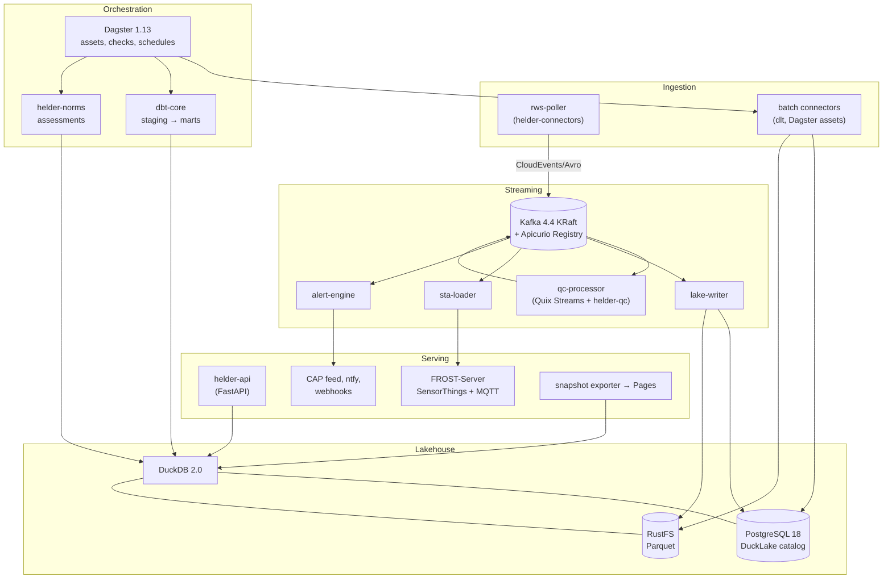
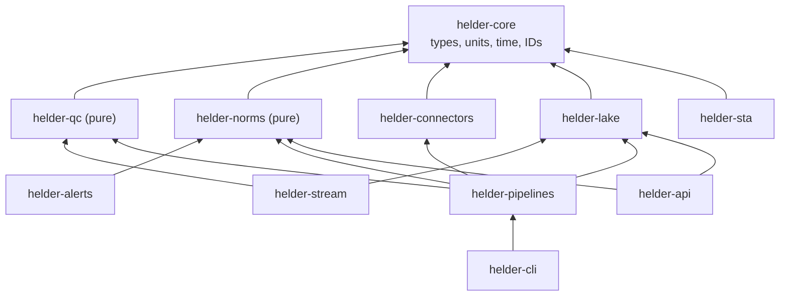
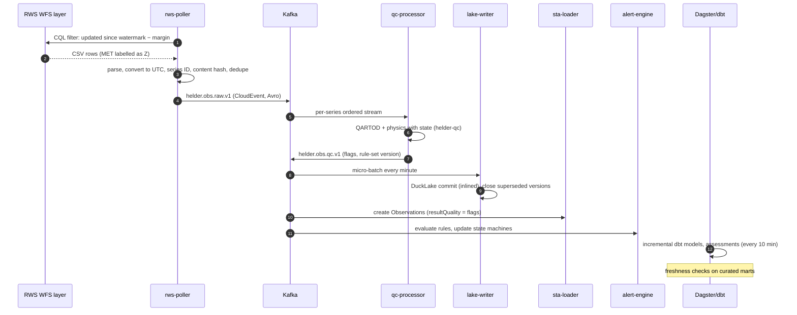
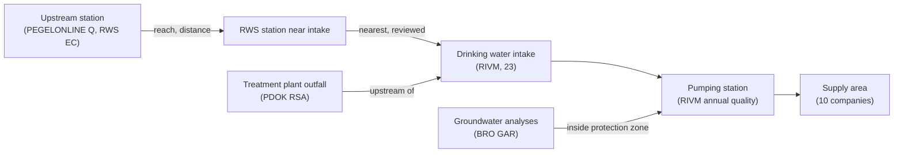

# Architecture

This document describes the target architecture of Helder in the arc42 spirit: goals and
constraints, context, building blocks, runtime flows, data design, deployment and cross-cutting
concerns. Decisions are explained in the [ADRs](adr/README.md); the order of construction is
in [ROADMAP.md](https://github.com/soheil-mp/helder/blob/main/ROADMAP.md).

## 1. Goals and quality attributes

Helder is an open data platform that turns Dutch water quality data into checked, explained,
real-time information: from river and lake sensors to bathing sites, groundwater and drinking
water.

| Quality attribute | Target (measured from M23) |
| :-- | :-- |
| **Freshness** | 95 % of followed sensor values are queryable through the API within 5 minutes of their appearance in the RWS latest layer; end to end (measurement to API) within 45 minutes |
| **Correctness** | Every value carries QC flags; every judgement carries its norm, aggregation rule, legal force and source; reproducible for any past date |
| **Explainability** | Every flag, status and alert links to its rule, parameters and input values |
| **Availability** | Degrades gracefully: if a source fails, the rest keeps working and the outage is shown |
| **Efficiency** | ≤ 2 GiB storage and ≤ 200 MiB downloads a day by default; the full stack runs on a 16 GB laptop |
| **Operability** | One command to start; dashboards, SLOs, runbooks and alerts as code |
| **Security and privacy** | No personal data, no accounts, least privilege, signed images, secrets never in Git |
| **Interoperability** | Aquo, OGC SensorThings API, OGC API Features, CAP 1.2, CloudEvents, ODCS, OpenAPI, AsyncAPI |

**Constraints:** no machine learning or model APIs ([ADR-0002](adr/0002-deterministic-rule-based-processing.md));
small data ([ADR-0003](adr/0003-small-data-by-design.md)); MIT licence with a dependency policy;
public sources only, used within their terms ([ADR-0020](adr/0020-privacy-attribution-and-source-terms.md)).

## 2. System context

```mermaid
flowchart LR
  subgraph Sources["Public sources"]
    RWS["Rijkswaterstaat<br/>WaterWebservices + WFS"]
    RIVM["RIVM geodata<br/>drinking water, intakes"]
    BRO["BRO (TNO)<br/>groundwater analyses"]
    EEA["EEA<br/>bathing water classes"]
    PDOK["PDOK<br/>locations, networks, areas"]
    PEG["PEGELONLINE<br/>Rhine discharge (DE)"]
    OM["Open-Meteo<br/>rainfall"]
  end
  H(("Helder"))
  subgraph Users["Consumers"]
    Public["Public dashboard<br/>(GitHub Pages)"]
    STA["SensorThings clients<br/>(QGIS, scripts)"]
    APIc["API clients"]
    Feeds["CAP feed readers,<br/>ntfy subscribers, webhooks"]
    Ops["Operator<br/>(Dagster, Grafana, CLI)"]
  end
  Sources --> H --> Users
```

## 3. Building blocks (containers)

| Container | Package | Responsibility |
| :-- | :-- | :-- |
| `rws-poller` | `helder-connectors` | Polls the RWS latest layer every 10 minutes, detects gaps, backfills through the API, emits raw observation events ([ADR-0005](adr/0005-rws-polling-strategy.md)) |
| batch connectors | `helder-connectors`, `helder-pipelines` | dlt sources for RIVM, BRO, EEA, PDOK, PEGELONLINE, Open-Meteo and RWS laboratory data; Dagster assets with budgets |
| Kafka + Apicurio | — | Event log and schema registry ([ADR-0006](adr/0006-kafka-event-backbone.md)) |
| `qc-processor` | `helder-stream`, `helder-qc` | QARTOD and physics checks per series with RocksDB state; emits flagged observations ([ADR-0007](adr/0007-quix-streams-shared-qc-library.md), [ADR-0012](adr/0012-qartod-quality-flags.md)) |
| `lake-writer` | `helder-lake` | Writes raw and flagged observations bitemporally into DuckLake micro-batches ([ADR-0009](adr/0009-bitemporal-observations.md)) |
| `sta-loader` | `helder-sta` | Maps registry and observations to SensorThings entities in FROST-Server |
| `alert-engine` | `helder-alerts` | Evaluates alert rules on flagged streams and curated marts; publishes CAP, CloudEvents and ntfy ([ADR-0016](adr/0016-alerts-cap-and-cloudevents.md)) |
| Dagster | `helder-pipelines` | Orchestrates batch work, dbt, assessments, compaction, exports and budget checks ([ADR-0010](adr/0010-dagster-orchestration.md)) |
| dbt project | `transform/` | Staging, intermediate and mart models with contracts and tests ([ADR-0011](adr/0011-dbt-transformations.md)) |
| `helder-api` | `helder-api` | Derived products over HTTP ([ADR-0015](adr/0015-sensorthings-and-fastapi-serving.md)) |
| FROST-Server | — | OGC SensorThings API 1.1 with MQTT |
| Web app | `web/` | Static SvelteKit dashboard with DuckDB-WASM ([ADR-0019](adr/0019-static-dashboard-duckdb-wasm.md)) |
| Observability | `deploy/obs/` | OpenTelemetry Collector, Prometheus, Grafana, Loki, Tempo, Pyrra |

### Package dependency rules

`helder-core`, `helder-qc` and `helder-norms` perform no I/O; import-linter enforces that and
the direction of every arrow.

## 4. Runtime flows

### 4.1 A sensor value from RWS to the dashboard

### 4.2 Gaps, revisions and replays

- **Gap:** the poller tracks the last phenomenon time per series; when the next value is more
  than one interval late, it schedules an API backfill for the gap, within the budget.
- **Revision:** a daily asset re-reads 7 days per followed series through the API; changed
  values or statuses become `helder.obs.revision.v1` events and new bitemporal versions.
- **Replay:** a new QC rule-set version can be applied by resetting the `qc-processor` consumer
  group to a timestamp (stream) or by a Dagster backfill over partitions (batch); the parity
  test guarantees equal results.

### 4.3 Assessments and alerts

1. dbt builds daily means, running annual means, percentiles and sample counts per series.
2. `helder-norms` evaluates every applicable norm (by property, scope and validity date) and
   writes `curated.norm_evaluation` rows with exceedance, headroom, sufficiency and citation.
3. The alert engine reads evaluations and flagged streams; firing alerts carry the snapshot ID
   and rule version.

## 5. Data design

### 5.1 Identifiers

- **Station:** `rws:<locatiecode>` (for example `rws:kinderdijk.lek`), `rivm:<pompstation>`,
  `bro:<GMW id>`, `eea:<bathingWaterIdentifier>`.
- **Series:** a UUIDv5 over (station, compartment, quantity, parameter, unit, condition,
  sampling height, programme), stable across runs and sources. The human-readable key is kept
  alongside.

### 5.2 Layers and core tables

| Schema | Table | Grain | Notes |
| :-- | :-- | :-- | :-- |
| `raw` | `rws_wfs_latest`, `rws_wws_observation`, `rivm_drinking_water`, `bro_gar_analysis`, `eea_bathing_status`, ... | As delivered | Allowlisted fields, source and retrieval metadata, content hash |
| `clean` | `observation` | Series × phenomenon time × recorded interval | Bitemporal; value, unit, censoring (`<`), source status and quality code, QC flags per test, aggregate flag, rule-set version |
| `clean` | `series`, `station`, `observed_property`, `source` | Registry (SCD2) | From catalogues and mapping tables |
| `curated` | `obs_hourly`, `obs_daily` | Series × hour/day | Means, min, max, counts, flag counts, coverage |
| `curated` | `norm_evaluation` | Series or station × norm × period | Exceedance, headroom, sufficiency, citation |
| `curated` | `intake_status`, `bathing_classification`, `travel_time_estimate`, `drinking_water_annual`, `groundwater_quality` | Use case specific | Each with an ODCS contract |
| `curated` | `alert`, `alert_event` | Alert × state change | With snapshot and rule versions |
| `serve` | views per API resource and export | — | Stable interface for API and snapshots |

### 5.3 Source-to-tap graph

Stored as edge tables with provenance (how each link was made: distance rule or manual review),
exposed through the API ("what feeds this intake?", "what is upstream of this pumping
station?").

### 5.4 Data budget

| Data | Default selection | Retention | Expected size |
| :-- | :-- | :-- | --: |
| Live sensor values | Watchlist (≈ 150–600 series) | Raw 90 days; hourly and daily forever | ≤ 500 MiB |
| RWS laboratory chemistry and microbiology | Watchlist stations, 2016 onward, selected parameters | Forever | ≤ 300 MiB |
| RIVM drinking water | All pumping stations, 2012 onward | Forever | ≤ 10 MiB |
| BRO groundwater | Protection zones of selected stations, last 10 years | Forever | ≤ 100 MiB |
| Geometries | Simplified, clipped | Forever | ≤ 50 MiB |
| Kafka | Raw topics 14 days, registries compacted | — | ≤ 300 MiB |
| Snapshots and compaction headroom | 30 days of DuckLake snapshots | — | ≤ 500 MiB |

The budget guard compares live usage with these numbers and fails closed.

## 6. Deployment

| Environment | How | Purpose |
| :-- | :-- | :-- |
| Laptop | `just up` → Docker Compose profiles | Development, demos |
| CI | Compose in GitHub Actions, recorded fixtures, fake RWS service | End-to-end tests on every pull request |
| Local cluster | k3d + Argo CD + Helm + operators | Production-like runs, chaos drills |
| Public demo | Scheduled GitHub Actions snapshot → GitHub Pages | Always-on, free |
| Optional cloud | OpenTofu module | Demonstration only; torn down after use |

## 7. Cross-cutting concerns

- **Time:** UTC everywhere inside Helder; source time zones are converted at the edge and tested.
- **Units:** Pint quantities in Python; units are part of the series identity and contracts.
- **Configuration:** Pydantic settings from environment variables; every variable in
  `.env.example`.
- **Resilience:** timeouts on every call, retries with jitter and budgets, circuit breakers per
  source, dead-letter topics, idempotent writes.
- **Observability:** OpenTelemetry traces across poller → Kafka (trace context in CloudEvents
  headers) → processors → lake; metrics for freshness, lag, budgets, QC flag rates; structured
  JSON logs; SLOs with error budgets (Pyrra).
- **Security:** non-root distroless-style images, read-only file systems, SBOMs, signed images
  verified by Kyverno, SOPS-encrypted secrets, least-privilege service accounts, dependency and
  licence policy, secret scanning in pre-commit and CI.
- **Privacy and attribution:** allowlisted fields; attribution in every response
  ([ADR-0020](adr/0020-privacy-attribution-and-source-terms.md)).
- **Documentation:** Diátaxis docs site, generated references (CLI, config, contracts, OpenAPI,
  AsyncAPI), runbooks next to alerts.

## 8. Risks

See the risk register in [ROADMAP.md](https://github.com/soheil-mp/helder/blob/main/ROADMAP.md#risks-and-mitigations).
