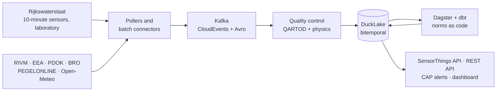

# Helder

**Real-time water quality for the Netherlands, from open data.** Helder collects public sensor
and laboratory data about rivers, lakes, the coast, bathing sites, groundwater and drinking
water. It checks every value with standard quality tests and judges it against the right legal
norm, with its source. It publishes the results through open standards and a public dashboard.

!!! note "Project status"

    Planning is complete and the engineering foundations are being laid (workspace, CI,
    dependency policy, these docs). The platform is built milestone by milestone; see the
    [roadmap](https://github.com/soheil-mp/helder/blob/main/ROADMAP.md) and the
    [open issues](https://github.com/soheil-mp/helder/issues).

## How it fits together

## Where to go next

- **Tutorials**: [set up a development environment](tutorials/development-setup.md), or
  [read live chloride at drinking water intakes](tutorials/read-live-chloride.md).
- **How-to guides**: [add a dependency](how-to/add-a-dependency.md),
  [sync the roadmap to issues](how-to/sync-roadmap-issues.md),
  [apply the repository settings](how-to/apply-repository-settings.md).
- **Reference**: [commands](reference/commands.md) and
  [environment variables](reference/environment.md).
- **Explanation**: the [architecture](architecture.md), the
  [water quality research](research/01-water-quality-domain.md), the
  [data sources](research/02-data-sources.md), the
  [technology choices](research/03-technology-landscape.md) and the
  [decision records](adr/README.md).

## Data and attribution

Helder uses public, non-personal environmental data from Rijkswaterstaat, RIVM, the European
Environment Agency, PDOK, the Key Register of the Subsurface (BRO), PEGELONLINE and Open-Meteo.
Every output names its sources and retrieval times. Helder is informational: for swimming,
drinking water or health advice, see the provinces (zwemwater.nl), your drinking water company
and RIVM.
